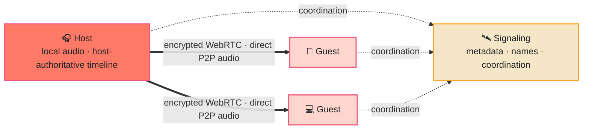

<div align="center">


# WaveSync

<a href="https://github.com/DharshanS-code/WaveSync">
  
</a>

<br />

<a href="https://dharshans-code.github.io/WaveSync/">
  
</a>
&nbsp;
<a href="https://github.com/DharshanS-code/WaveSync/stargazers">
  
</a>

<br /><br />


<br /><br />

<p align="center">
  <a href="#-features">Features</a> ·
  <a href="#-run-locally">Run locally</a> ·
  <a href="#-signaling-and-deployment">Deployment</a> ·
  <a href="#-interface-and-local-preferences">Interface</a> ·
  <a href="#-timing-and-wi-fi-limitations">Timing</a> ·
  <a href="#-reliability-and-privacy">Privacy</a> ·
  <a href="#-documentation">Docs</a> ·
  <a href="#-license">License</a>
</p>

</div>

WaveSync is a mobile-first music PWA. A host selects local audio, guests receive it directly over encrypted WebRTC, and a host-authoritative timeline coordinates playback. No accounts or server-side audio upload. Actual acoustic synchronization depends on browser, device, network and output route; perfect or submillisecond accuracy is not guaranteed.



## ✨ Features

- 🎧 Local browser-decoded audio with bounded current/next caching.
- 🎶 Playlist append, track selection, previous/next, removal and keyboard/pointer reordering; repeat and shuffle.
- 🎛️ Host-only transport controls; guest local volume, explicit audio activation and manual resync.
- 🔁 Stable track/transfer identity, serialized file transfer and backpressure/resource limits.
- 🔄 Live-room identity resume, peer rebuilding, authoritative pause on host loss and deliberate re-entry after expired recovery.
- 🎨 Original responsive music interface, light/dark/system themes and accents, accessible labels/focus/live errors, safe-area and reduced-motion support.
- 📊 Estimated clock/output diagnostics and adaptive delivery buffering; unavailable Wi-Fi hardware information is explicitly not fabricated.
- 📦 Versioned offline application shell and safe user-requested updates outside active rooms.
- 🧭 Persistent desktop navigation and a keyboard-accessible mobile drawer; dedicated Settings, Privacy Policy and optional creator-support pages.
- 🎚️ Local Channel System Beta: Off by default, with independent Left/Right/Off output for hosts and guests, mono fallback and short live gain transitions.
- 💾 Remembered/default volume, automatic-sync and event-notification preferences, capability-gated output selection, and confirmed local-data controls.

> [!NOTE]
> Audio format support follows actual browser `decodeAudioData`; unsupported or corrupt files produce an error. Full transfer/decode is required before guest playback: this is not progressive streaming.

<p align="right"><sub><a href="#wavesync">↑ Back to top</a></sub></p>

## 🚀 Run locally

```bash
npm install --ignore-scripts
npm run build
npm run dev -- --profile self-hosted
```

> [!TIP]
> Open **http://localhost:3000**. Create a room, add audio, wait for clock calibration, and press Play. In another browser/device, enter the room code or use the invitation link. Guests may need to tap **Enable audio**.

> [!WARNING]
> The local server binds loopback, so another phone cannot use your laptop's localhost. Physical LAN tests require trusted HTTPS/WSS or your deployed infrastructure. Never use plaintext ws from an HTTPS page.

```bash
npm test
npm run lint
npm run build
npm run test:browser
```

> [!IMPORTANT]
> The `lint` command verifies syntax/imports/assets, not ESLint or static types. Ordinary `npm run build` produces the neutral **`dist/self-hosted/`** artifact. `npm run build:official` explicitly produces **`dist/official/`**. Each has its own content-derived service-worker revision and exact SHA-256 inventory. Deploy **only the selected child directory**, never the parent `dist/`, legacy files or repository root. Rebuild after editing source; the profile server serves built files.

<details>
<summary><b>📱 Android shared storage / PRoot</b></summary>

<br />

On Android shared storage: `npm install --ignore-scripts --bin-links=false`. Debian PRoot Chromium tests may require `WAVESYNC_PROOT_BROWSER=1 npm run test:browser`; see development notes for the explicitly approved local test-only sandbox exception.

</details>

<p align="right"><sub><a href="#wavesync">↑ Back to top</a></sub></p>

## 📡 Signaling and deployment

Local loopback default: `ws://localhost:8787/api/room`. Self-hosted public builds have **no default signaling service** and never fall back to the official Worker. Configure your own public WSS endpoint in `config/deployment.json`, then rebuild:

```json
{
  "signalUrl": "wss://your-signaling.example/api/room",
  "operator": "Your deployment name",
  "providerNote": "Describe your signaling and hosting providers. Default STUN discovery uses Google."
}
```

Leave `signalUrl` blank to produce an unconfigured build with a setup notice and disabled Create/Join. Invalid supplied public URLs fail the build. Public query/saved overrides remain ignored; loopback testing overrides remain supported. Invitations share room codes, never private resume tokens. Official-only endpoint inputs are in `official/deployment.json`; they are selected only by the explicit official build (or exact upstream repository identity in Pages CI).

Self-hosted artifacts contain no creator-support module, payment data, support route/markup/styles, personal promotional UI or runtime feature-config fetch. MIT license/upstream attribution remains. Build separation prevents accidental inheritance, not deliberate copying: a public endpoint is not a secret or an access-control mechanism. Backend authorization/abuse policy requires separate deployment work.

For phone-only Cloudflare dashboard publishing, use the complete `backend/dashboard-worker.js` file and preserve the existing `ROOMS` → `RoomDO` binding; see [DEPLOYMENT.md](DEPLOYMENT.md).

> [!IMPORTANT]
> **The re-engineered frontend and backend must be deployed together.** The public Worker may still run the old protocol until its owner deploys the matching backend. Local verification does not establish production endpoint compatibility. No paid service or production deployment is required for local work.

See [DEPLOYMENT.md](DEPLOYMENT.md) before publishing. STUN helps direct connectivity but is not TURN; cross-NAT or client-isolated Wi-Fi can fail. Host-star upload grows with guest count; the room limit is eight guests.

<p align="right"><sub><a href="#wavesync">↑ Back to top</a></sub></p>

## 🎨 Interface and local preferences

Home, Settings and Privacy Policy use hash views so refresh/back/forward remain compatible with static subdirectory hosting; Support is an official-only extension. An active room has its own navigation item; going Home or opening Settings does not leave the room or stop playback. Only Home shows the global footer.

Buttons share subtle press feedback and fine-pointer hover states. Static theme-aware gradients add depth to artwork/elevated surfaces; page, drawer and confirmation motion uses only opacity/transform. Navigation remains immediately usable. Standalone PWA opening has a short once-per-document, nonblocking reveal, not a delayed splash screen. OS and app reduced-motion settings disable decorative movement; actual OS-controlled splash animation is outside the app's control.

Settings applies Light/Dark/System theme immediately. Default volume is saved separately from optional remembered playback volume. Channel System Beta is off by default; when enabled, both hosts and guests get a local Left/Right/Off selector. Left or Right duplicates the chosen source channel into both local output speakers. Off preserves stereo; mono stays mono. These settings never enter room messages. Turning automatic synchronization off disables guest alignment/corrections until manual resync or re-enablement; host pause/departure still pauses the guest.

Notification categories, optional browser notifications and event sounds are local preferences. Permission is requested only on explicit enablement. Output selection appears only where Web Audio/browser capabilities support it. Reset/clear actions require confirmation and do not delete server data or terminate rooms. Clear removes only `wavesync.*` local-storage entries; browser site settings can also remove cached app files.

### 💝 Official build: show or hide Support the Creator

This system is emitted only by `npm run build:official`; changing a flag cannot add it to self-hosted artifacts. For an official build, edit **`config/features.json`**:

```json
{ "supportCreator": true }
```

Change **`true`** to **`false`** to hide it, or **`false`** to **`true`** to show it. Missing/invalid/failed config hides the entry and blocks the support view. Runtime fetch uses `no-store`; the service worker does not cache this flag. Editing a served config takes effect on reload without rebuilding application code. A repository edit still needs the usual Pages build/deployment to publish the file.

Support uses only the owner-supplied UPI ID and a generated QR/UPI intent, with optional amounts. WaveSync does not verify payments. QR algorithm tests do not replace scanning with a real UPI app.

The asset family is generated locally with `python3 -I scripts/generate-assets.py .`. See [DESIGN.md](DESIGN.md) for the design contract.

<p align="right"><sub><a href="#wavesync">↑ Back to top</a></sub></p>

## 🕒 Timing and Wi-Fi limitations

Clock calibration maps monotonic local timestamps to server time using independent midpoint samples, with an explicitly symmetric-path assumption and uncertainty. Playback uses the Web Audio clock, output timestamp mapping where available, and bounded gradual/hard correction. Rate adjustment can alter pitch. Browser latency APIs are implementation estimates, not external acoustic calibration.

Ordinary browsers do not expose RSSI, Wi-Fi link speed, frequency band/channel, PHY or congestion. Optional Network Information API downlink/effectiveType/saveData are coarse estimates. Actual transfer throughput/stalls and matched peer delivery variation guide buffering/timeouts/preloading. RTT is not a direct Wi-Fi-quality or output-latency measurement. Native Android/desktop Wi-Fi instrumentation would require a separate native boundary and permission/API review; none is fabricated or required here.

<p align="right"><sub><a href="#wavesync">↑ Back to top</a></sub></p>

## 🔐 Reliability and privacy

Server validates host role/identity, host↔guest signaling, epochs, track identity, sequences and bounded payloads. File and decoded-memory budgets help low-memory devices, but decode checking occurs after the browser allocates PCM. Signaling carries metadata/names and coordination; audio remains direct P2P. Local preferences/history remain in the current browser and can be cleared using site-data controls.

Room resume is in-memory and time-limited. Node/Cloudflare object restart loses room state and requires a fresh room. Offline shell does not mean offline room functionality. Background playback, mobile interruptions, real Wi-Fi/output-device conditions and acoustic divergence need physical testing.

<p align="right"><sub><a href="#wavesync">↑ Back to top</a></sub></p>

## 📚 Documentation

- 🏗️ [Architecture and audio/sync pipeline](ARCHITECTURE.md)
- 🛠️ [Development and PRoot environment](DEVELOPMENT.md)
- 🧪 [Tests and physical-device acceptance matrix](TESTING.md)
- 🚢 [Deployment and protocol migration](DEPLOYMENT.md)
- 📝 [Unreleased engineering changes](CHANGELOG.md)

<p align="right"><sub><a href="#wavesync">↑ Back to top</a></sub></p>

## 📄 License

[MIT](LICENSE). The new original WaveSync identity and owner-supplied optional support information are included.

<div align="center">

<br />

<a href="https://dharshans-code.github.io/WaveSync/">
  
</a>


</div>
