<div align="center">

# 🎧 WaveSync

### Your music. Your room. In sync.

**A local-first, mobile-friendly music PWA for listening together — with direct peer-to-peer audio transfer and host-led playback coordination.**

<p>
  
  
  
  
</p>

<p>
  <a href="#-highlights">Highlights</a> ·
  <a href="#-how-it-works">How it works</a> ·
  <a href="#-get-started">Get started</a> ·
  <a href="#-deployment">Deployment</a> ·
  <a href="#-documentation">Docs</a>
</p>

</div>

---

## ✨ The idea

WaveSync lets one person host a listening room while friends join from their own devices. The host chooses audio stored locally; guests receive the selected tracks directly through **WebRTC data channels**. A host-authoritative timeline coordinates playback without uploading audio to a central media server.

> [!IMPORTANT]
> WaveSync aims for coordinated playback, not guaranteed perfect synchronization. Real-world timing depends on the browser, device, network and audio output route. Perfect or submillisecond accuracy is not promised.

## 🚀 Highlights

<table>
  <tr>
    <td width="50%">
      <h3>🎵 Your files stay yours</h3>
      Decode local audio in the browser and transfer it directly to room peers. No account or server-side audio upload is required.
    </td>
    <td width="50%">
      <h3>⏱️ Coordinated playback</h3>
      Host-led transport, clock calibration, adaptive buffering and guest-side synchronization corrections.
    </td>
  </tr>
  <tr>
    <td width="50%">
      <h3>📱 Made for small screens</h3>
      Responsive music interface, accessible mobile navigation, safe-area support and reduced-motion preferences.
    </td>
    <td width="50%">
      <h3>🎨 Make it yours</h3>
      Light, dark or system theme, accent choices, remembered volume and configurable local notifications.
    </td>
  </tr>
  <tr>
    <td width="50%">
      <h3>🔁 A proper listening queue</h3>
      Append, select, reorder, remove, skip, repeat and shuffle tracks.
    </td>
    <td width="50%">
      <h3>🧰 Built for imperfect networks</h3>
      Transfer backpressure, resource limits, peer recovery, diagnostics and manual resynchronization.
    </td>
  </tr>
</table>

### More in the box

- **Room recovery:** live-room identity resume, peer rebuilding and deliberate re-entry after expired recovery.
- **Guest controls:** local volume, explicit audio activation and manual resync.
- **Channel System Beta:** optional Left / Right / Off output selection, mono fallback and short gain transitions. Off by default.
- **Offline shell:** versioned application shell with safe, user-requested updates outside active rooms.
- **Privacy controls:** local preferences and history, plus confirmed controls for clearing WaveSync local data.
- **Official-only support extension:** optional creator-support interface is kept out of self-hosted builds.

## 🧭 How it works

```mermaid
flowchart LR
    H["🎧 Host device<br/>Local audio files"]
    S["Room signaling<br/>WebSocket"]
    G1["📱 Guest device"]
    G2["💻 Guest device"]
    H -->|"Room coordination"| S
    S <-->|"Join / peer setup"| G1
    S <-->|"Join / peer setup"| G2
    H ==>|"Audio data · WebRTC"| G1
    H ==>|"Audio data · WebRTC"| G2
    H -.->|"Authoritative timeline"| G1
    H -.->|"Authoritative timeline"| G2
```



1. The host creates a room and selects local audio.
2. Guests join with a room code or invitation link.
3. Signaling helps peers establish their WebRTC connections.
4. Audio is transferred directly from the host to each guest.
5. The host timeline coordinates playback while guests can manage their own local volume.

<details>
<summary><strong>What is sent through the signaling service?</strong></summary>

Signaling carries room coordination, peer connection setup and metadata such as track information. Audio is transferred peer-to-peer. Invitations share room codes, never private resume tokens.

</details>

## ⚡ Get started

### Requirements

- Node.js and npm
- A modern browser with Web Audio and WebRTC support
- Audio files supported by the browser's `decodeAudioData`

### Run locally

```bash
git clone https://github.com/DharshanS-code/WaveSync.git
cd WaveSync
npm install --ignore-scripts
npm run build
npm run dev -- --profile self-hosted
```

Open **http://localhost:3000**.

### Start a listening room

| Host | Guest |
|:--|:--|
| 1. Create a room | 1. Enter the room code or open the invite |
| 2. Add local audio | 2. Wait for the host to share the track |
| 3. Wait for clock calibration | 3. Tap **Enable audio** if prompted |
| 4. Press Play | 4. Listen and adjust local volume |

> [!NOTE]
> The local development server binds to loopback. Another phone cannot join using your computer's `localhost`. For physical LAN testing, use trusted HTTPS/WSS or your deployed infrastructure. Do not use plaintext `ws://` from an HTTPS page.

### Useful commands

| Command | Purpose |
|:--|:--|
| `npm run dev -- --profile self-hosted` | Run the self-hosted development server |
| `npm run build` | Build the self-hosted profile |
| `npm run build:official` | Build the official profile |
| `npm test` | Run unit and integration tests |
| `npm run lint` | Verify syntax, imports and assets |
| `npm run test:browser` | Run browser tests |

The `lint` command is a project validation script; it is not ESLint or a static type checker.

## 🏗️ Build profiles

WaveSync has deliberately separated **self-hosted** and **official** build outputs.

| Profile | Output | Intended use |
|:--|:--|:--|
| Self-hosted | `dist/self-hosted/` | Your own deployment; no creator-support module |
| Official | `dist/official/` | Official deployment with optional support extension |

Each profile has its own content-derived service-worker revision and SHA-256 inventory.

> [!WARNING]
> Deploy **only the selected child directory** — never the parent `dist/`, repository root or legacy files. Rebuild after changing source files; the profile server serves built output.

Self-hosted artifacts do not include creator-support UI, payment data, support routes or runtime feature-config fetching. This separation prevents accidental inclusion; it is not a security boundary against deliberate copying.

## 🌐 Deployment

Self-hosted public builds have **no default signaling service** and do not fall back to the official Worker. Configure your own public WSS endpoint in `config/deployment.json`, then rebuild:

```json
{
  "signalUrl": "wss://your-signaling.example/api/room",
  "operator": "Your deployment name",
  "providerNote": "Describe your signaling and hosting providers. Default STUN discovery uses Google."
}
```

Leave `signalUrl` blank to create an unconfigured build with a setup notice and disabled Create/Join controls. Invalid supplied public URLs fail the build.

For phone-only Cloudflare dashboard publishing, use the complete `backend/dashboard-worker.js` file and preserve the existing `ROOMS` → `RoomDO` binding.

**Deploy the re-engineered frontend and backend together.** The public Worker may still use an older protocol until its owner deploys the matching backend. Local verification alone does not prove production endpoint compatibility.

<details>
<summary><strong>Network and room limits</strong></summary>

- STUN helps peers discover direct connectivity; it is not TURN.
- Cross-NAT networks or client-isolated Wi-Fi may prevent peer connections.
- Host upload demand grows with the number of guests.
- A room is limited to eight guests.
- No paid service or production deployment is required for local development.

</details>

See **[DEPLOYMENT.md](DEPLOYMENT.md)** for the full deployment and protocol migration guide.

## 🎚️ Timing, audio and Wi-Fi realities

WaveSync calibrates clocks using independent midpoint samples and an explicitly symmetric-path assumption. Playback uses the Web Audio clock, output timestamp mapping where available, and bounded gradual or hard correction.

A few important boundaries:

- Rate adjustment can alter pitch.
- Browser latency APIs provide implementation estimates, not external acoustic calibration.
- Ordinary browsers do not expose Wi-Fi RSSI, link speed, frequency band, channel, PHY or congestion.
- Optional Network Information API values such as downlink and effective connection type are coarse estimates.
- Throughput, stalls and peer delivery variation help guide buffering; RTT alone is not a Wi-Fi-quality or output-latency measurement.
- Full file transfer and decode are required before guest playback. **This is not progressive audio streaming.**

## 🔐 Privacy and reliability

| Area | Design |
|:--|:--|
| Audio | Direct peer-to-peer transfer; no server-side audio upload |
| Accounts | No account required |
| Local data | Preferences and history stay in the current browser |
| Invitations | Room codes only; private resume tokens are not shared |
| Room recovery | In-memory and time-limited; a server restart requires a fresh room |
| Resource handling | Bounded transfer, backpressure and file/decoded-memory budgets |
| Permissions | Notification permission is requested only after explicit enablement |

Clearing WaveSync data removes only `wavesync.*` local-storage entries. Browser site-data controls may also remove cached application files. Reset actions do not delete server data or terminate rooms.

> [!CAUTION]
> An offline application shell does not mean offline room functionality. Background playback, mobile interruptions, real Wi-Fi conditions and acoustic divergence still need physical-device testing.

## 📚 Documentation

<table>
  <tr><th>Guide</th><th>What you'll find</th></tr>
  <tr><td><a href="ARCHITECTURE.md">🏛️ Architecture</a></td><td>Application structure, audio and synchronization pipeline</td></tr>
  <tr><td><a href="DEVELOPMENT.md">🛠️ Development</a></td><td>Development workflow and PRoot environment notes</td></tr>
  <tr><td><a href="TESTING.md">🧪 Testing</a></td><td>Test commands and physical-device acceptance matrix</td></tr>
  <tr><td><a href="DEPLOYMENT.md">🚀 Deployment</a></td><td>Build profiles, hosting and protocol migration</td></tr>
  <tr><td><a href="DESIGN.md">🎨 Design</a></td><td>Visual and interaction design contract</td></tr>
  <tr><td><a href="CHANGELOG.md">📝 Changelog</a></td><td>Unreleased engineering changes</td></tr>
</table>

## 🧪 Testing checklist

- [ ] Host creates a room and adds local audio
- [ ] Guest joins from a separate device/browser
- [ ] Guest enables audio and receives the complete track
- [ ] Host transport changes coordinate with guests
- [ ] Guest local volume remains independent
- [ ] Reconnect and room recovery behavior is checked
- [ ] Mobile navigation, reduced motion and safe areas are checked
- [ ] Physical-device behavior is tested on the target network

Automated tests are useful, but they do not replace real-device checks across browsers, networks and audio output routes.

## 🤝 Contributing

Bug reports, focused improvements and documentation fixes are welcome. Before making a change, read the relevant guide in the [documentation](#-documentation), run the applicable checks, and describe the devices/browsers used when reporting playback or synchronization behavior.

## 📄 License

WaveSync is released under the **[MIT License](LICENSE)**.

<div align="center">

---

**🎶 Keep it local. Keep it together.**

<sub>Built for shared listening, with realistic expectations about browser and network timing.</sub>

</div>
